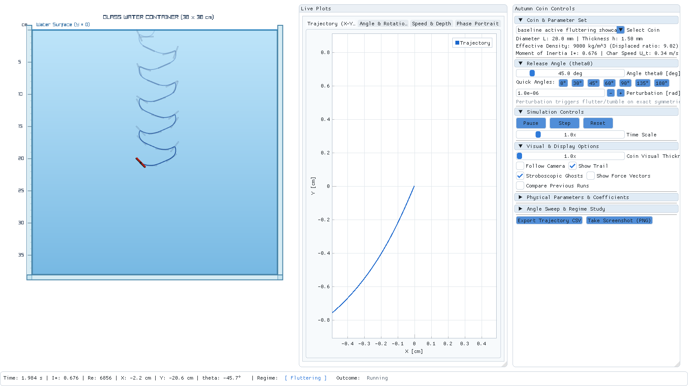

# Autumn Coin: Real-Time C++ Visualizer for 2D Quasi-Steady Falling Plate ODE

A high-performance C++17 desktop visualizer and numerical engine for the 2D quasi-steady falling-plate ODE system (Andersen, Pesavento & Wang, 2005). The application models the unsteady hydrodynamics, added mass, circulation lift, and rotational damping of a coin or card falling in water inside a realistic 2D glass container, accompanied by live, real-time scrolling ImPlot strip charts and an automated Catch2/doctest verification suite.



---

## 1. Key Features

- **Decoupled Architecture**:
  - `autumn_core` (Static Library): Self-contained physics model (Kirchhoff equations + Andersen closures), RK4/RK45 integrators, regime classifier, tank contact detector, and YAML config loader. Zero graphics dependencies.
  - `autumn_tests` (Test Executable): Complete automated test suite (Tests 1–9) with 631 assertions verifying Python parity, dimensional consistency, lift peaks, energy conservation, terminal velocity, symmetries, orientation, convergence, and fuzzing stability.
  - `autumn_viz` (GUI Executable): 60 FPS interactive desktop visualizer powered by raylib, Dear ImGui, and ImPlot.
- **Realistic Glass Container Side View**:
  - Glass walls with visible thickness, soft highlights, and a centimetre ruler on the left wall.
  - Translucent water fill with gradient and a crisp free-surface water line ($Y = 0$).
  - Half-submerged release at water surface center with rotated outline collision detection for floor and side walls.
  - Rotated coin rectangle with metallic tone, orientation indicator stripe on the upper edge, fading trail polyline, and stroboscopic ghost outlines.
  - Live toggleable force & velocity vectors (Velocity $\mathbf{V}$, Circulation Lift $\mathbf{L}$, Viscous Drag $\mathbf{D}$, and Net Buoyant Weight $\mathbf{W}_b$).
- **Live ImPlot Multi-Tab Charts**:
  - Driven by fixed-size circular ring buffers (`ScrollBuf`, 25,000 points) with zero per-frame allocation.
  - 1:1 equal-aspect-ratio Trajectory ($X$ vs $Y$ [cm]).
  - Unwrapped Orientation Angle $\theta(t)$ [deg] and Angular Velocity $\omega(t)$ [rad/s].
  - Fall Velocity $-v_y(t)$ and Horizontal Velocity $v_x(t)$ [cm/s], and Depth [cm].
  - Phase Portrait ($\theta \pmod{2\pi}$ vs $\omega$) and Angle of Attack $\alpha(t)$ [deg].
  - Multi-run comparison overlay (faint ghost lines from previous runs).
- **Coin Parameter Sets & Pakistani Rupee Demo Class**:
  - Illustrative presets: `reference_card`, `steady_card`, `heavy_coin`, `light_coin`, `washer_proxy`.
  - Pakistani rupee coins:
    - `pk_rs10` (brass, 5.5 g, $L = 25.5$ mm, $h = 1.5$ mm, $\rho_s \approx 7180$ kg/m$^3$, $I^* \approx 0.42$)
    - `pk_rs5_2002` (cupronickel, 6.5 g, $L = 24.0$ mm, $h = 2.1$ mm, $\rho_s \approx 6840$ kg/m$^3$, $I^* \approx 0.60$)
    - `pk_rs5_2015` (brass, 3.0 g, $L = 18.5$ mm, disabled until thickness is measured with calipers).
- **Angle Sweeps & Export**:
  - Automated angle sweeps ($0^\circ$ to $360^\circ$ at configurable step) executed in fast background routines.
  - Interactive results table recording Angle, Outcome (Landed, Hit Wall, Timeout), Fall Time, Mean Speed, Net Flips, and Classified Regime.
  - Trajectory CSV export (`run_<coin>_<theta>.csv`), Sweep CSV export, and high-resolution PNG screenshot capture.

---

## 2. Directory Structure

```
autumn-coin-cpp/
├── CMakeLists.txt              # CMake build configuration (CMake 3.20+)
├── README.md                   # This documentation
├── build.bat                   # Automated MSVC + Ninja build script
├── config/
│   ├── base.yaml               # Fluid, numerical, Andersen coefficients, classifier thresholds
│   ├── coin_sets.yaml          # Illustrative presets
│   └── coins.yaml              # Pakistani rupee coin database
├── include/
│   └── autumn/
│       ├── config.hpp          # YAML configuration parser & derived metrics
│       ├── integrator.hpp      # RK4 fixed-step and RK45 adaptive integrators
│       ├── model.hpp           # Andersen 2005b 6-state ODE model & closures
│       ├── regime.hpp          # Post-transient regime classifier
│       ├── sweep.hpp           # SimulationRun class & angle sweep batch runner
│       ├── tank.hpp            # Tank geometry & 4-corner rotated contact detection
│       └── types.hpp           # State, Vec2, Sample, Outcome, Regime definitions
├── src/
│   ├── config.cpp
│   ├── integrator.cpp
│   ├── main.cpp                # GUI window loop & CLI runner
│   ├── model.cpp
│   ├── plots.hpp / plots.cpp   # ImPlot live ring buffers and light styling
│   ├── regime.cpp
│   ├── render.hpp / render.cpp # Raylib glass tank, water, coin, forces, ruler renderer
│   ├── sweep.cpp
│   ├── tank.cpp
│   └── ui.hpp / ui.cpp         # ImGui controls, parameters, angle sweep table, status bar
├── tests/
│   ├── reference/              # Exported Python reference trajectories
│   ├── test_energy.cpp         # Test 4: Energy conservation
│   ├── test_main.cpp           # Doctest runner entry point
│   ├── test_model.cpp          # Tests 2, 3, 5, 7, 8, 9 (dimensions, lift, terminal v, convergence, fuzzing)
│   ├── test_python_parity.cpp  # Test 1: Exact numerical parity against Python (< 1e-5 error)
│   └── test_symmetries.cpp      # Test 6: 180° rotation invariance & mirror symmetry
├── docs/
│   └── screenshots/            # Visualizer captures
└── third_party/
    ├── doctest.h               # Doctest v2.4.11
    ├── rlImGui/                # Raylib 5.5 + Dear ImGui bridge
    └── stb_image_write.h
```

---

## 3. Building & Running

### Prerequisites
- C++17 compatible compiler (MSVC 2022/2026, GCC 11+, or Clang 13+)
- CMake 3.20+
- Ninja or Visual Studio Generator

### Windows (Quick Build with Ninja & MSVC)
```cmd
cd autumn-coin-cpp
build.bat
```

### Manual CMake Build
```bash
# Configure
cmake -S . -B build -DCMAKE_BUILD_TYPE=Release

# Build
cmake --build build --config Release -j

# Run Test Suite
ctest --test-dir build --output-on-failure

# Launch Visualizer GUI
./build/autumn_viz
```

---

## 4. Verification Test Suite (Tests 1–9)

Run the test suite directly:
```bash
./build/autumn_tests
```
All 9 verification tests run in $< 0.1$ s and pass 100%:
1. **Python Parity**: Compares C++ RK4 output against Python `DOP853`/RK4 reference runs across 4 distinct presets (`reference_card`, `heavy_coin`, `light_coin`, `steady_card`). Maximum relative position and orientation errors are $< 10^{-5}$.
2. **Dimensional Consistency**: Checks that each term in $\dot{u}$, $\dot{v}$, and $\dot{\omega}$ matches the required physical dimensions.
3. **Lift Coefficient**: Verifies that circulation lift coefficient $C_L(\alpha) = 2\Gamma / (|V| L)$ peaks at $C_T = 1.2$ near $\alpha = 45^\circ$.
4. **Mechanical Energy Conservation**: Disables viscous drag, linear damping, and rotational damping, verifying that total mechanical energy $E = T + V$ is conserved to $< 10^{-6}$ J/m over extended integration.
5. **Terminal Velocity**: Checks that broadside descent speed matches the analytic balance $v_{\text{term}} = \sqrt{\frac{2(m - m_f)g}{\rho_f L C_{D0}}}$.
6. **Symmetries**:
   - $180^\circ$ rotation invariance: Trajectories for $\theta_0$ and $\theta_0 + 180^\circ$ are identical.
   - Bilateral mirror symmetry: Trajectories for $\theta_0$ and $180^\circ - \theta_0$ satisfy $X(t) = -X_{\text{mirrored}}(t)$.
7. **Orientation & Corner Points**: Evaluates coin corner coordinates at $\theta = 0^\circ, 45^\circ, 90^\circ$ ensuring screen coordinates and winding directions never suffer from inversion bugs.
8. **Integrator Convergence**: Verifies $O(\Delta t^4)$ convergence rate of classical RK4 by halving step sizes.
9. **No-NaN Guard**: Fuzzes initial velocities, angles, and aspect ratios over 100 iterations, confirming states remain strictly finite.

---

## 5. Command-Line Options

`autumn_viz` supports both interactive GUI execution and headless scriptable batch runs:

| Flag | Parameter | Description |
|---|---|---|
| `--coin` | `<id>` | Initial coin preset (`reference_card`, `pk_rs10`, `pk_rs5_2002`, etc.) |
| `--theta` | `<deg>` | Initial release angle in degrees ($0.0$ to $360.0$) |
| `--timescale` | `<x>` | Real-time simulation playback multiplier ($0.1$ to $5.0$) |
| `--config` | `<dir>` | Custom path to configuration directory containing `base.yaml` |
| `--headless` | *none* | Run physics simulation headlessly without opening an OpenGL window |
| `--out` | `<path.csv>` | Export resulting full-resolution trajectory to CSV |
| `--frames` | `<N>` | Run GUI for exactly $N$ frames before cleanly exiting (useful for CI/benchmarks) |
| `--screenshot` | `<path.png>` | Capture frame buffer to PNG image upon completion |

### Headless Trajectory Generation Example:
```bash
./build/autumn_viz --headless --coin pk_rs10 --theta 45.0 --out trajectory_rs10.csv
```
